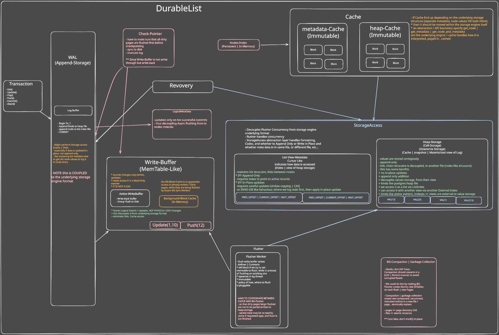

# Architecture

#### NOTE NOT FULLY Implemented yet

### Missing

- Indexes allocation Desing, Impl
- WriteBuffer and BgFlusher Integration Into the Engine
- WAL impl
- Cache(s)
  

# Architecture Notes, Limitiations

## WAL No Force

- Log buffer is unbounded, which is not feasible for large transactions
- No Force
- this means we can LOG Redo Entries only, No need for Undo since we don't flush to WriteBuffer till Commited
- BUT it simplifies Indexes, Flushing to Cell storage, Cached List Version

## Indexes Allocation

- Since No Force, Single Threaded Transactions, Thus Nodes Indecies could be allocated by storage engine
- Since transactions are sequential, Max_Index is incremented only after Commit
- REQUIRES (Re-Design OR On Transaction commit validation) When BG Flusher and WriteBuffer are integrated, since this makes id increments Async, thus newly created transactions may see and ID snapshot that is yet to be incremented (since writes may still be in WriteBuffer or in flush process by BGFlusherWorker)
  OR Decouple LIST SiZE METADATA FROM DISK, BG FLUSHER (should be seprate component, updated only on successfully commit)

## MVCC Support

- Requires Stable ID allocation for each Node => |CheckSum|ID|Node_Val|
- Requires TXN Id for each Physical Node on disk => |CheckSum|ID|Node_Val|TXID|
- Requires WriteBuffer to store each write/update tagged with TXID, so that it can be queried by Reads
- Requires Re-Design of Index allocation
  (either complete redesign OR Before&After atomic Index read + validation on
  commit that it has not changed from the transaction local snapshot )
